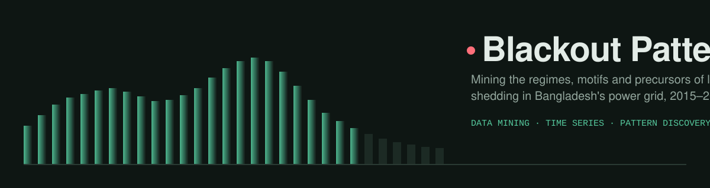
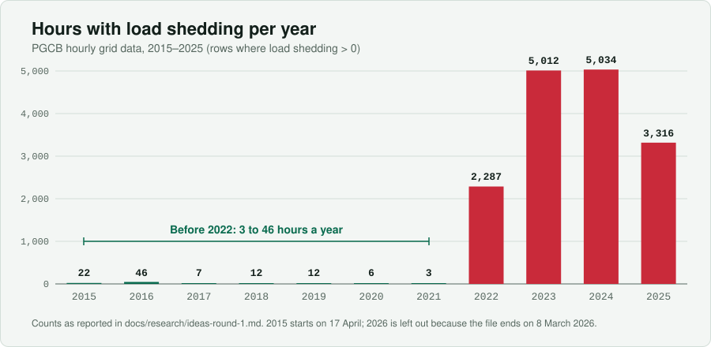
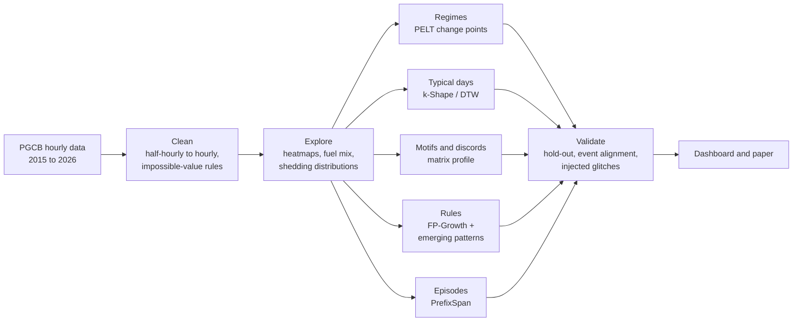
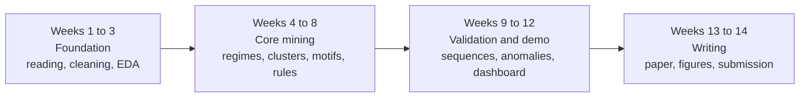

<p align="center">
  
</p>

<p align="center">
  
  
  
  
  
</p>

# Blackout Patterns

A data mining project on Bangladesh's load-shedding crisis. It looks for the **structure** of the crisis in eleven years of hourly grid data: when the regime changed, what a typical bad day looks like, which fuel-mix conditions come before a blackout, and which odd readings are real events and which are data errors.

> **Where this stands.** The research is done and the plan is written. Weeks 1–3 are done: a cleaning pipeline, a profile command and the exploratory analysis, all run on the real file (v1, 94,934 rows × 15 columns) and covered by tests. The result is the [data report](docs/data-report/README.md). The mining (regimes, clusters, motifs, rules) has not started.

## Getting started

```bash
pip install -e ".[dev]"
python scripts/download_data.py   # prints where to save the raw files
```

Download the main dataset from [Mendeley Data](https://data.mendeley.com/datasets/vpk8spw2mm/1) and save it as `data/raw/pgcb_hourly_mendeley.csv`. Then:

```bash
blackout inspect   # raw columns, and the role each one was matched to
blackout clean     # writes data/interim/hourly_clean.parquet and a cleaning report
blackout profile   # compares yearly shedding hours with the figures in this README
blackout eda       # writes the data-report figures to docs/data-report/figures/
pytest             # cleaning-rule tests (synthetic data)
```

Columns are matched to roles (timestamp, generation, load shedding, gas, liquid fuel, imports…) by keyword. On the real file (`datetime`, `generation_mw`, `demand_mw`, `load_shedding`, `gas`, `liquid_fuel`, `coal`, `hydro`, `solar`, `wind`, four import columns, `remarks`) every column is matched correctly; pin a wrong match with `--map role=column` if a later version renames them.

**What the first run on the real data showed**

- The raw yearly counts of rows with shedding above 0 MW reproduce the chart above exactly (22, 46, 7 … 2,287, 5,012, 5,034, 3,316).
- The cleaned table counts **hours**, so its 2022–2025 totals are 4–5% lower (2,178 / 4,788 / 4,816 / 3,158). The file has one extra off-the-hour reading a day (19:30, sometimes 18:30). On a shedding evening both it and the 19:00 row are above zero, and the chart counts that hour twice. Hours are the better unit; the chart counts rows.
- The glitches are much more widespread than the first profile suggested: besides 64.5 million MW generation, liquid fuel reaches 29 million MW and hydro has dozens of readings above 1,000 MW when the real figure is near 265 MW. Cleaning therefore uses a ceiling per source (in [`src/blackout/config.py`](src/blackout/config.py)), chosen from the upper tail of the real data, instead of one global limit. About 210 readings are set to NaN in total, and no rows are removed.
- The Spearman correlation between daily changes in liquid fuel and load shedding comes out at 0.00 for 2018–2021 and 0.45 for Jul 2022–2024 (the pilot reported 0.01 and 0.43).

The ceilings are judgement calls and should be revisited during EDA, particularly shedding (6,000 MW) and liquid fuel (12,000 MW).

## Contents

- [Getting started](#getting-started)
- [The problem in one chart](#the-problem-in-one-chart)
- [Research question](#research-question)
- [What is different about this project](#what-is-different-about-this-project)
- [Data](#data)
- [Approach](#approach)
- [Evaluation](#evaluation)
- [Planned outputs](#planned-outputs)
- [Expected findings](#expected-findings)
- [Timeline](#timeline)
- [Stretch goals](#stretch-goals)
- [Risks and limits](#risks-and-limits)
- [Repository layout](#repository-layout)
- [Status and next steps](#status-and-next-steps)
- [Paper and venues](#paper-and-venues)
- [Key references](#key-references)

---

## The problem in one chart

From 2015 to 2021 Bangladesh's grid hardly ever shed load: between 3 and 46 hours a year. Then, after the LNG and foreign-currency crisis, it went to thousands of hours a year. That break is a natural experiment sitting inside a single public file.

<p align="center">
  
</p>

The counts come from a first profile of the data, recorded in [`docs/research/ideas-round-1.md`](docs/research/ideas-round-1.md). A second, smaller sign of the same break: in a pilot check, day-to-day changes in liquid-fuel generation were unrelated to changes in load shedding before the crisis (Spearman correlation 0.01) and clearly related during it (0.43).

## Research question

> **What operating regimes and recurring patterns characterise Bangladesh's 2022–2025 load-shedding crisis, and which fuel-mix conditions systematically come before shedding?**

Broken into four parts:

| # | Sub-question | Method family |
|---|---|---|
| 1 | When did the grid change regime, and does that line up with known events? | Change-point detection |
| 2 | What does a typical day look like in each regime? | Time-series clustering, motif discovery |
| 3 | Which fuel-mix and calendar conditions come before shedding? | Association rules, emerging patterns, sequential patterns |
| 4 | Which strange readings are data errors, and which are real events? | Discord discovery, anomaly detection |

## What is different about this project

The same grid data has already been used in published work, but only for **forecasting demand** or **predicting** shedding. No published work found so far has mined the crisis for its patterns.

| | Existing work on this data | Blackout Patterns |
|---|---|---|
| Goal | Predict a number (demand, shedding) | Describe and explain the structure of the crisis |
| Learning | Supervised (random forest, XGBoost, deep nets) | Mostly unsupervised and pattern-level |
| Output | A forecast and an error score | Regimes, archetype days, rules, a list of audited glitches |
| Question | "How much load will be shed?" | "What changed, what repeats, and what comes first?" |

## Data

The main dataset is public and CC BY 4.0. It is small (6.55 MB), so everything runs on a laptop.

| Dataset | Role | Size and shape | Source |
|---|---|---|---|
| **Hourly electricity generation, demand, load shedding and fuel mix, 2015–2026** (BUET authors) | Main dataset | 6.55 MB CSV, 94,934 rows × 15 columns, 2015-04-17 to 2026-03-08 | [Mendeley Data](https://data.mendeley.com/datasets/vpk8spw2mm/1) |
| PGCB Hourly Generation Dataset | Cross-check (UCI mirror) | 6.8 MB XLSX, 92,650 × 14 | [UCI #1175](https://archive.ics.uci.edu/dataset/1175/pgcb+hourly+generation+dataset) |
| Daily electricity with division-level load shedding (BPDB), 2019–2024 | Optional: regional patterns | 2.07 MB | [Mendeley Data](https://data.mendeley.com/datasets/x7r7wdb39k/1) |
| BMD daily weather, 35 stations, to 2023 | Optional: weather join | 42 MB | [Mendeley Data](https://data.mendeley.com/datasets/tbrhznpwg9/1) |

**Known data problems** (found in a first inspection of the main file):

- The earliest rows are half-hourly, the rest hourly.
- There are impossible values: a maximum "generation" of 64,526,500 MW in 2023 and a load-shedding value of 65,359 MW in 2017.
- Solar is about 22% missing and wind about 74% missing.
- "Demand" is censored during shedding, because it records what was served. The analysis will use generation plus shedding instead.

Raw data files are **not** stored in this repository (see [`.gitignore`](.gitignore)). Download them from the links above.

## Approach



Each task has a simple baseline, so that the more interesting method has something to beat:

| Task | Baseline | Interesting method |
|---|---|---|
| **Regimes** | Calendar split (before 2022 vs 2022 onward) | PELT change points on daily shedding energy, liquid-fuel share and import share, compared with known events such as the mid-2022 halt of spot LNG purchases |
| **Typical days** | k-means on raw 24-hour vectors | k-Shape and DTW clustering per regime; matrix-profile motifs for recurring multi-day patterns |
| **Rules** | Apriori support and confidence on all years | FP-Growth plus **emerging patterns**: rules whose support grows by a factor of k or more between regimes, ranked by lift and conviction |
| **Episodes** | Count of shedding hours | PrefixSpan on shedding episodes, for example gas falls → liquid fuel rises → evening peak → shedding |
| **Glitches and events** | Z-score outliers | Matrix-profile discords plus Isolation Forest on STL residuals; the top 50 labelled as *data error* or *real event* |

For the rules, the hourly data will be discretised into states such as season, hour band, gas share (low / mid / high), liquid-fuel share and import level, for example:

```
{season = summer, hour band = evening peak, gas share = low, liquid share = high}  →  {shedding = high}
```

Support, lift and conviction are used instead of confidence alone, because some rules will be obvious ("summer evening means shedding") and need to be ranked below the surprising ones.

**Toolkit** (all free): `pandas` and `pyarrow` are the core dependencies and are in use now. The rest are declared as optional extras in [`pyproject.toml`](pyproject.toml) and get installed as each phase starts: `scikit-learn`, `mlxtend`, `tslearn`, `stumpy`, `ruptures`, `statsmodels` (`.[mining]`), and `matplotlib` and `streamlit` for the demo (`.[viz]`).

## Evaluation

| Part | How it is judged |
|---|---|
| Clusters | Silhouette score, Davies–Bouldin index, and bootstrap ARI for stability |
| Rules | Lift, conviction, leverage, and a **temporal hold-out**: mine on 2022–2024, then check whether the rules still hold in 2025 |
| Change points | Alignment with documented events within ±7 days |
| Anomalies | Precision@50 from manual labelling, and recall on synthetic glitches injected at known positions |

## Planned outputs

- **Crisis fingerprint**: a day-of-year × hour heatmap of shedding for every year.
- **Regime timeline**: change points drawn over a stacked fuel-mix area chart.
- **Archetype days**: cluster centroids of the daily profile for each regime.
- **Matrix profile plot** with motifs and discords marked.
- **Rule table**: the top emerging rules, with their growth rates between regimes.
- **Streamlit dashboard**: year slider, regime view and a rule explorer.
- *(Stretch)* a matched comparison of NOx and PM2.5 during shedding and non-shedding hours.

## Expected findings

These are hypotheses to test, not results.

1. A sharp regime break in mid-2022 and a partial recovery in 2025. *(First look: both visible; the 2025 recovery is mostly a fall in the amount shed, down 83%, more than in the number of shedding days.)*
2. Shedding concentrated in the evening peak and late at night. *(First look: not in 2023–2024, when shedding was spread across the whole day; closer to true in 2025. Midnight is missing from the source, so it cannot be checked.)*
3. High-lift rules linking a low gas share and high liquid-fuel generation to shedding. *(First look: liquid-fuel share was highest in 2022 and fell afterwards, so this may hold for one regime only.)*
4. A cluster of obvious data-entry glitches, since the first inspection already turned up several impossible values.

## Timeline

A 14-week plan, in four phases.



| Week | Work |
|---|---|
| 1 | Read the four related papers, download both PGCB versions, reproduce the first profile, set up the repo and a notebook template |
| 2 | Cleaning: half-hourly to hourly, impossible-value rules, merge the UCI and Mendeley versions, missing solar and wind policy, document everything |
| 3 | EDA: yearly heatmaps, fuel-mix trends, shedding distributions. **Checkpoint: data report** |
| 4 | Change-point detection (PELT, several penalties) to get regimes; event alignment table |
| 5 | Daily-profile clustering: k-means baseline vs k-Shape and DTW; choose k; check stability |
| 6 | Matrix profile (STUMPY): motifs and discords; start labelling discords |
| 7 | Discretisation design for rule mining (season, hour band, fuel-share terciles, import levels); Apriori baseline |
| 8 | FP-Growth and emerging-pattern mining across regimes; interestingness ranking. **Mid-term demo** |
| 9 | PrefixSpan on shedding episodes; temporal hold-out validation of the rules on 2025 |
| 10 | Anomaly detection evaluation (injected glitches and labelled discords). Optional: division-level BPDB data for regional patterns |
| 11 | Stretch: air-quality contrast (see below) |
| 12 | Build the Streamlit dashboard |
| 13 | Write the paper (IEEE 6-page template): introduction, related work, method, results |
| 14 | Final figures, limitations, demo polish, course report submission; prepare a conference version |

## Stretch goals

Three extensions are worth doing only if the core work finishes early. All are described in the research notes.

| Extension | Idea | Why it is a stretch |
|---|---|---|
| **Load shedding and air quality** | Compare NOx, CO and PM2.5 in shedding hours against matched non-shedding hours (same station, month, hour, day type), using the CAMS-BD air-quality data. When the grid sheds load, diesel generators switch on. No Bangladesh study of this was found. | Hard. The air-quality files need heavy cleaning, shedding is national while pollution is local, and shedding peaks in months when PM is naturally low. |
| **Dependency-structure shift** | Show how the *relationships* between fuel types changed at the regime break, using Granger tests, PCMCI or graphical lasso, and test whether the graphs differ more than chance. | Causal claims are fragile, so results would be described as "dependency structure". |
| **Event-grounded detector benchmark** | Use documented real events (the 2022 grid crisis, the DSE floor price, Eid) as ground truth to compare change-point and anomaly detectors. | A different paper. A pilot showed standard detectors find all four events within about a week, but also return up to 14 breakpoints. |

## Risks and limits

- **Censored demand.** Demand is not observed during shedding. The plan is to work with generation plus shedding.
- **Obvious rules.** Many rules will be trivial. Ranking by lift, conviction and emerging-pattern growth rate, not confidence, is meant to handle this.
- **Association is not causation.** The regime changes line up with policy and market events. The project can show alignment with them but cannot prove they caused anything.
- **Data quality.** Impossible values and a lot of missing solar and wind data. Every cleaning rule needs to be written down and justified.
- **The data may change.** Datasets get new versions. The first step of the project is to re-run the profile on whatever version is current.
- **Prior work may appear.** Before committing, search Google Scholar for the dataset DOI to check nothing new was published after the research was done (7 October 2026).

## Repository layout

```
Blackout-Patterns/
├── README.md                      You are here
├── .gitignore                     Keeps raw data and Python clutter out of git
├── pyproject.toml                 Package, dependencies, `blackout` command
├── src/blackout/
│   ├── config.py                  Paths, dataset sources, cleaning thresholds
│   ├── clean.py                   Column-role matching, hourly resampling, impossible-value rules
│   ├── profile.py                 Reproduces the README's first profile
│   ├── eda.py                     Figures and tables for the data report
│   └── cli.py                     `blackout inspect | clean | profile | eda`
├── scripts/download_data.py       Says where to save the raw files and checks them
├── tests/test_clean.py            Cleaning-rule tests on synthetic data
├── assets/
│   ├── banner.svg                 README banner
│   └── shedding-hours-per-year.svg   Chart used in this README
└── docs/
    ├── data-report/
    │   ├── README.md              Week 3 checkpoint: data quality and a first look
    │   └── figures/               Fingerprint heatmap, fuel mix, hour-of-day profile, size histogram
    ├── research/
    │   ├── ideas-round-1.md       12 candidate projects, with the full write-up of this one (Idea 1)
    │   ├── ideas-round-2.md       7 further research-oriented ideas, including extensions of this one
    │   └── sources.md             Every dataset, paper and page that was checked, grouped by idea
    └── report-workbench/
        ├── index.html             Offline, tabbed HTML version of the idea reports
        └── DESIGN_BRIEF.md        How that HTML report is designed and how to reuse it
```

Data lives in `data/raw/` and `data/interim/` (both git-ignored). Notebooks, when they arrive, go in `notebooks/`.

The research notes cover more projects than this one, because Blackout Patterns was picked from that list. Idea 1 in [`ideas-round-1.md`](docs/research/ideas-round-1.md) is the full write-up for this project, and Section 5.1 holds the detailed plan.

To browse the idea reports as a tabbed page, open [`docs/report-workbench/index.html`](docs/report-workbench/index.html) in a browser after cloning the repo.

## Status and next steps

- [x] Search for datasets and check them (about 50 candidates logged)
- [x] Compare 19 project ideas and pick this one
- [x] Write the research question, method plan and 14-week schedule
- [x] Set up the repository and structure
- [x] Write the cleaning pipeline and profile command
- [x] Download the data and re-run the first profile (`blackout inspect`, `clean`, `profile`)
- [x] EDA and the data report (week 3 checkpoint): [docs/data-report](docs/data-report/README.md)
- [ ] Decide the rule for the missing midnight hour; merge the UCI version as a cross-check; decide the solar / wind policy
- [ ] Hand-check the 14 hours above 3,000 MW and revisit the cleaning ceilings
- [ ] Regimes, clusters, motifs, rules
- [ ] Validation, dashboard, paper

## Paper and venues

**Working title:** *Blackout Patterns: Mining Regimes, Motifs and Emerging Fuel-Mix Rules in Bangladesh's Hourly Grid Data, 2015–2026*

Target venues, from the research notes:

- **ICCIT 2027** is the realistic target. The 2026 deadline has passed. [iccit.org.bd](https://iccit.org.bd/)
- IEEE Region 10 events (TENSYMP and R10-HTC 2027; check the current calls).
- The *Tackling Climate Change with ML* workshop (a 2027 edition is likely but unconfirmed). [climatechange.ai](https://www.climatechange.ai/events/neurips2026)
- ICECE is held every two years, so the next one is 2028. [icece.buet.ac.bd](https://icece.buet.ac.bd/)

## Key references

**Prior work on the same data (forecasting and prediction)**

- Islam, Turja & Habib (2025). *Enhanced power demand forecasting for Bangladesh…* Journal of Data, Information and Management. [doi:10.1007/s42488-025-00140-9](https://doi.org/10.1007/s42488-025-00140-9)
- Yeaser, Nafs & Hossain (2025). *Comparative Analysis of Deep Learning Models for Long-Term Electricity Demand Forecasting in Bangladesh Using Web-Scraped Data.* ECAI 2025. [doi:10.1109/ECAI65401.2025.11095479](https://doi.org/10.1109/ECAI65401.2025.11095479)
- Arifuzzaman (2026). *An Intelligent Machine Learning Based Load Shedding Prediction and Smart Energy Management Framework…* IEEE SPICSCON 2026. [vu.edu.bd](https://vu.edu.bd/publications/3168/an-intelligent-machine-learning-based-load-shedding-prediction-and-smart-energy-management-framework-for-power-grid-optimization-in-bangladesh)

**Methods**

- Yeh et al. (2016). *Matrix Profile I.* IEEE ICDM. [doi:10.1109/ICDM.2016.0179](https://doi.org/10.1109/ICDM.2016.0179)
- Killick et al. (2012). *Optimal detection of changepoints with a linear computational cost* (PELT). [doi:10.1080/01621459.2012.737745](https://doi.org/10.1080/01621459.2012.737745)
- Paparrizos & Gravano (2015). *k-Shape: Efficient and accurate clustering of time series.* SIGMOD. [doi:10.1145/2723372.2737793](https://doi.org/10.1145/2723372.2737793)
- Dong & Li (1999). *Efficient mining of emerging patterns.* [doi:10.1145/312129.312191](https://doi.org/10.1145/312129.312191)
- FP-Growth: [doi:10.1145/342009.335372](https://doi.org/10.1145/342009.335372) · PrefixSpan: [doi:10.1109/ICDE.2001.914830](https://doi.org/10.1109/ICDE.2001.914830) · Isolation Forest: [doi:10.1109/ICDM.2008.17](https://doi.org/10.1109/ICDM.2008.17)
- Runge et al. (2019). *Detecting and quantifying causal associations in large nonlinear time series datasets* (PCMCI). *Science Advances.* [doi:10.1126/sciadv.aau4996](https://doi.org/10.1126/sciadv.aau4996)

The full list, with every dataset and page that was checked, is in [`docs/research/sources.md`](docs/research/sources.md).

---

<p align="center">
  <sub>Author: <a href="https://github.com/Ariffurrhmn">Arifur Rahman</a> · This repository has no licence file. The datasets named above carry their own licences (CC BY 4.0).</sub>
</p>
