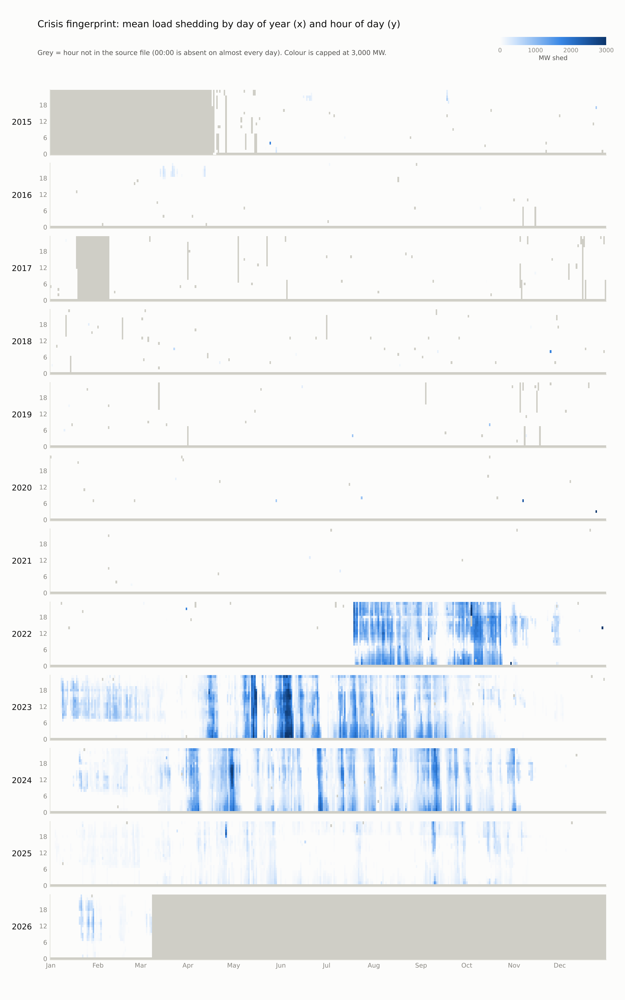
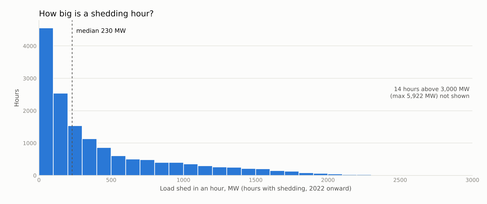
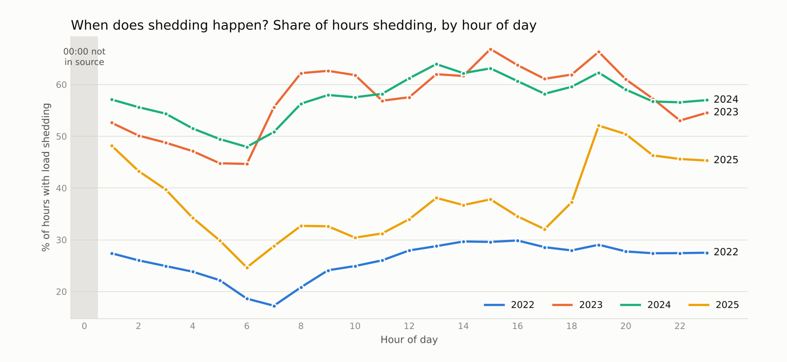
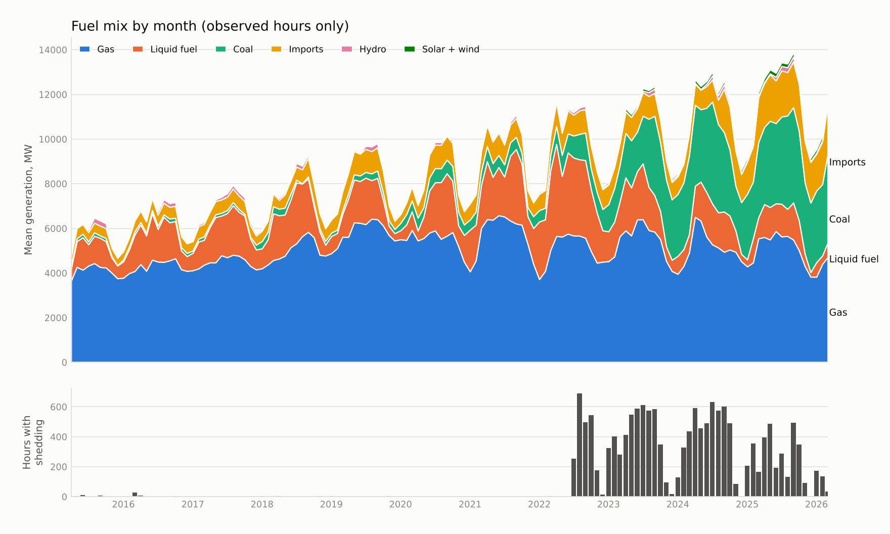

# Data report (week 3 checkpoint)

What the cleaned hourly table looks like, what is wrong with it, and what a first look says about the four research questions. Everything here is descriptive: it comes from `blackout clean` and `blackout eda` on the Mendeley file (v1, 94,934 rows × 15 columns, 2015-04-17 to 2026-03-08). Nothing has been tested yet, so treat the readings below as leads for the mining phase, not findings.

Reproduce: `blackout clean && blackout eda` (figures land in `docs/data-report/figures/`).

## 1. Data quality

| Issue | What was found | What the pipeline does |
|---|---|---|
| **Midnight is missing** | 00:00 is observed on 0.1% of days. The raw file has two midnight rows in total. Every other hour is observed on 98–99% of days. | Missing hours are added as empty rows with `observed = False`. Nothing is imputed. |
| **Off-the-hour rows** | About one extra reading per day (19:30, sometimes 18:30), plus half-hourly rows in early 2015. | Folded into the hour by averaging. This is why hourly shedding counts are 4–5% below the raw row counts quoted in the README. |
| **Long gap** | 518 consecutive hours missing in Feb 2017; shorter gaps of 12–27 hours in 2015, 2017 and 2019. | Left empty. |
| **Impossible values** | About 210 readings in 10 columns: 64.5 million MW generation, 29.2 million MW liquid fuel, 76,292 MW from a single import link, 56 hydro readings above 500 MW (real hydro is about 265 MW at most). | Set to NaN with a `flag_bad_*` column. Ceilings are per source and live in `src/blackout/config.py`. |
| **Solar and wind** | Solar is 21.7% missing and wind 74.3% (observed rows only). Missingness is not random: solar has no values at all in 2015–2016. | Left as NaN with a flag. The policy for fuel shares is still to be decided. |
| **Demand is censored** | Reported demand records what was served. | `supply_mw` = generation + shedding is used instead. |

Consequence of the missing midnight: any 24-hour profile built from this table has 23 usable points, and the claim that shedding is concentrated "late at night" cannot be checked at the hour that matters most. Where both neighbouring hours were observed in 2022 and later, 615 of 1,513 days had shedding at both 23:00 and 01:00, so midnight shedding was very likely common. The profile and clustering steps need a stated rule for midnight (drop it, or interpolate and flag it). I would drop it and cluster on 23 hours.

## 2. What the data shows

### Shedding frequency and size

| Year | Hours with shedding | Days with any shedding | Energy shed (million MWh, observed hours) |
|---|---|---|---|
| 2015–2021 | 3 to 38 per year | 3 to 14 | about 0.01 or less |
| 2022 (from July) | 2,178 | 130 | 1.74 |
| 2023 | 4,788 | 295 | 2.59 |
| 2024 | 4,816 | 284 | 2.08 |
| 2025 | 3,158 | 276 | 0.36 |
| 2026 (to 8 Mar) | 341 | 28 | 0.07 |

- In 2023 and 2024 there was shedding on about 80% of all days.
- A typical shedding hour is small: the median is 230 MW and 90% are below 1,223 MW. 14 hours exceed 3,000 MW, with a maximum of 5,922 MW (see the ceiling caveat below).
- **The 2025 "recovery" is mostly about size, not frequency.** Hours with shedding fell by about a third from 2024, days with any shedding barely changed (284 to 276), but the energy shed fell by 83%.

The fingerprint shows the structure directly: nothing before mid-2022, then a block from July 2022, long stretches of near-continuous shedding in Apr–Oct of 2023 and 2024, an almost empty Nov–Dec every year, and a much lighter 2025.

### When in the day

This does not support the hypothesis that shedding is "concentrated in the evening peak and late at night":

- **2023 and 2024:** shedding is spread across the whole day, 45–67% of hours at every hour of the day. It is lowest at 05:00–06:00 and highest in the afternoon, with a bump at 19:00.
- **2025:** the pattern changes to a clear evening and night shape. Shedding rises from about 37% of hours at 18:00 to 52% at 19:00 and stays at 45–52% until 01:00, then falls to 25% by 06:00. Daytime hours sit at 29–38%.
- **Winter 2023:** in Jan–Feb 2023, shedding is a *daytime* event (76–85% of hours between 08:00 and 19:00) and almost absent between 01:00 and 06:00. That is a different kind of day from the summer pattern, and a good candidate for its own cluster.
- **Season:** in 2023 and 2024 shedding hit 49–89% of hours in each month from April to October, but only 0–14% in November and December. January to March was patchy (18–63%).

### Fuel mix

| Year | Mean generation, MW | Gas share | Liquid fuel share | Coal share | Imports, MW |
|---|---|---|---|---|---|
| 2019 | 8,311 | 70% | 16% | 3% | 848 |
| 2021 | 9,369 | 61% | 23% | 6% | 837 |
| 2022 | 9,989 | 51% | **30%** | 9% | 948 |
| 2023 | 10,518 | 52% | 16% | 22% | 968 |
| 2024 | 11,119 | 46% | 12% | 30% | 1,182 |
| 2025 | 11,905 | 43% | 9% | 30% | 1,909 |

- Gas output has been flat at about 5,000–5,800 MW since 2019. All the growth in generation since then came from coal (from 236 to 3,541 MW) and imports (from 848 to 1,909 MW).
- Liquid fuel peaked in 2022 and fell every year after, while shedding peaked in 2023–2024. So "high liquid-fuel share before shedding" may describe 2022 only. That is exactly what the emerging-pattern step (rules whose support changes between regimes) is designed to check, and it should be treated as an open question, not an expectation.
- Coal's rise from 2023 and the jump in imports in 2025 line up with the lighter 2025. This is an alignment, not evidence of cause.

## 3. What this changes in the plan

| README hypothesis | After the first look |
|---|---|
| Sharp break in mid-2022 | **Supported.** The first shedding block starts in July 2022. |
| Partial recovery in 2025 | **Supported, with a qualification.** Mostly a fall in the amount shed (-83%) rather than the number of shedding days (-3%). |
| Shedding concentrated in the evening peak and late night | **Not supported for 2023–2024** (all day), **partly supported for 2025**. Midnight cannot be checked. |
| Low gas share and high liquid fuel precede shedding | **Open.** Liquid fuel share was highest in 2022 and fell afterwards; the rule may be specific to one regime. |
| A cluster of data glitches | **Supported**, and larger than first thought (see section 1). |

New items for the plan:

1. Decide the rule for the missing midnight hour before clustering and the matrix profile.
2. Regime detection should use shedding *energy* as well as shedding hours, because the 2025 change shows up in one and barely in the other.
3. Cluster summer and winter days separately, or expect the winter daytime pattern to form its own archetype.
4. Review the ceilings. The 6,000 MW shedding ceiling removes 14 readings, and the 14 hours above 3,000 MW that remain (maximum 5,922 MW) are worth checking by hand, since the median is 230 MW.
